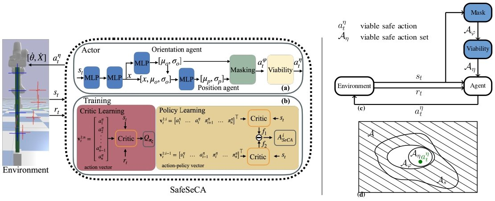

#  SafeSeCA


## 📖 Abstract




---

This paper introduces SafeSeCA, a new Multi-Agent Reinforcement Learning (MARL) framework designed for a 3D deformation of large soft Deformable Linear Objects (DLOs) using safe and viable actions. By providing the robot with actions kinematically feasible according to the current robot's kinematic configuration that we denominate as viable actions; with the use of continuous action masking via zonotope-based ray masks we provide safe actions. This proactive approach eliminates the need for external constraints. The framework tackles the challenges of controlling these complex objects by using two cooperative agents to manage gripper translation and rotation, thereby simplifying the action space into a safe and viable action space. We adapt Sequential Credit Assignment (SeCA) for continuous actions and off-policy learning to handle credit assignment in this cooperative setup with a shared reward. Additionally, a sequential agent architecture is introduced to improve policy coordination. Simulation results in PyBullet demonstrate that SafeSeCA can effectively learn DLO deformation policies while guaranteeing safe and viable robot actions.


## 📁 Folder structure

```bash
SafeSeCA/
├── README.md
├── requirements.txt
├── src/               
    ├──configs/
        ├──config.json              # Config file for environment, reward, dataset, batch size and folder to load weights
        ├──db.txt                   # Database for training, same as db_seen.txt
        ├──db_unseen.txt            # Database for testing, unseen deformations
        ├──db_seen.txt
    ├──SeCA/
        ├──config/
            ├──default.yaml         # Config for the networks, number of environments, masking and viability
            ├──algs/
                ├──seca.yaml        # Config for the entropy, embeding dimension and hypernet layer
        ├──weights/
            ├──seca_off_policy/     # Action replacement weights
            ├──safeSeca/            # SafeSeCA weights

```

## 🛠️ Installation
### Requirements
- Python 3.9+
- Linux
- PyTorch 2.5 or higher

### Python requierements can be installed with 
```bash
pip install -r requirements.txt
```


##  Training
```bash
cd src
python main_parallel_off_policy_action_masking.py --config_file ./src/configs/config.json --algo_config_file seca 
```

When training you can setup the trainig to use it with or withou out masking and viabilty in the src/SeCA/config/default.yaml file.

 
## 🚀 Testing
```bash
cd src
python main.py --mode test --config_file ./src/configs/config.json --algo_config_file seca --gui True
```

## Generate dataset
```bash
cd src
python main.py --mode generate_db --config_file ./src/configs/config.json --algo_config_file seca --gui True
```
